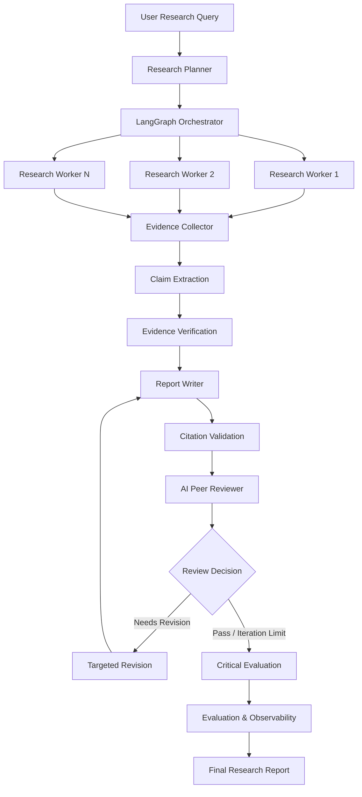

# 🔬 ResearchMind
### Multi-Agent AI Research & Evidence Verification System

ResearchMind is an intelligent multi-agent research platform built using **Python, LangGraph, LangChain, and Google Gemini**. It automates the research lifecycle through intelligent query decomposition, parallel web research, evidence collection, factual claim verification, citation auditing, and automated report generation.Unlike a conventional LLM-powered research assistant, ResearchMind introduces a structured verification and quality-assurance pipeline. Every extracted factual claim is evaluated against retrieved source evidence, while generated reports undergo automated peer review and targeted revisions.
It also provides an interactive Streamlit dashboard, a FastAPI backend, and an evaluation framework for measuring research quality and execution performance.

---

## 🎯 What Makes ResearchMind Different?

| Conventional AI Research | ResearchMind |
|---|---|
| Generates answers directly | Decomposes queries into research tasks |
| Sequential information gathering | Concurrent research execution |
| Trusts generated statements | Independently verifies factual claims |
| Basic source citations | Citation integrity auditing |
| Single-pass report generation | Automated review and revision |
| Limited quality measurement | Quantitative evaluation and observability |

**Core idea:** A citation being valid does not necessarily mean that it supports the associated claim. ResearchMind evaluates both independently.

---

## ✨ Key Capabilities

## ✨ Key Capabilities

- 🧠 Research Planning & Execution:
- Decomposes complex queries into focused research subquestions using structured Pydantic outputs and executes independent research tasks concurrently using `ThreadPoolExecutor`.

- 📚 Evidence Collection & Verification:
- Collects and deduplicates source metadata, extracts atomic factual claims, and verifies them against retrieved source passages to identify unsupported or contradictory information.

- 🔗 Report Generation & Citation Auditing:
- Generates structured research reports, validates source references, and calculates citation integrity scores to ensure evidence-backed reporting.

- 🔄 Automated Review & Revision:
- Evaluates report coverage, evidence quality, citations, and contradictions, then applies targeted revisions using reviewer feedback within a configurable      iteration limit.

- 📊 Evaluation & Observability:
- Measures claim support, citation validity, task completion, execution latency, and token consumption to assess research quality and performance.

- 🖥️ Dashboard & API Integration:
-  Provides interactive execution monitoring, evidence inspection, claim verification, and report exports through Streamlit, with research execution and management endpoints powered by FastAPI.

---

## 🏗️ System Architecture

ResearchMind uses a state-driven multi-agent architecture orchestrated through LangGraph.

### End-to-End Workflow



### The 7 Core Components

#### 01. Research Planner – Intelligent Query Decomposition

**Objective:** Transform an unstructured research question into an actionable research plan.

- Uses Google Gemini for research planning.
- Generates structured outputs using Pydantic models.
- Creates 2–5 focused research subquestions.
- Organizes questions across dimensions such as architecture, benchmarks, limitations, and future outlook.
- Validates subquestion IDs, focus areas, and search queries.

**Core components:** `ResearchState`, `ResearchPlan`, `SubQuestion`, `planner_node`

#### 02. Research Orchestrator – Concurrent Information Retrieval

**Objective:** Gather relevant information from multiple research dimensions efficiently.

- Dispatches independent research workers concurrently.
- Uses Python `ThreadPoolExecutor`.
- Preserves source URLs, titles, and snippets.
- Deduplicates sources retrieved across different workers.
- Handles individual search failures without losing successful results.

**Core components:** `orchestrator.py`, `EvidenceCollection`

#### 03. Claim Verification – Evidence-Based Fact Checking

**Objective:** Determine whether generated factual claims are actually supported by retrieved evidence.

**Claim Extraction**
- Converts research findings into individual atomic claims.
- Structures claims for independent verification.

**Evidence Verification**
- Compares claims against retrieved source passages.
- Rejects unknown or fabricated source references.
- Detects conflicting and contradictory information.

**Verification Verdicts**

| Verdict | Interpretation |
|---|---|
| 🟢 Supported | Evidence corroborates the claim |
| 🔴 Contradicted | Evidence conflicts with the claim |
| 🟡 Partially Supported | Only some parts of the claim are supported |
| ⚪ Insufficient Evidence | Available evidence cannot establish the claim |

**Core components:** `claim_extraction_node`, `evidence_verification_node`, `verdict_node`

#### 04. Report Generation – Structured Research Synthesis

**Objective:** Convert verified findings into a structured research report.

The report writer generates Markdown reports containing:

1. Executive Summary
2. Key Findings
3. Verified Claims & Disclosures
4. Limitations
5. References

**Citation Validation**

- Validates source references such as `[S1]` and `[S2]`.
- Checks references against verified source records.
- Flags unverified citations.
- Calculates a citation integrity score.

**Core components:** `report_writer_node`, `citation_validation_node`

#### 05. AI Peer Review – Automated Quality Assurance

**Objective:** Evaluate report quality and improve weak sections before publication.

The reviewer assesses four dimensions:

| Dimension | Evaluation |
|---|---|
| Coverage | Are all planned research questions addressed? |
| Evidence Quality | Are findings supported by evidence? |
| Citation Integrity | Are citations valid and properly grounded? |
| Contradictions | Are conflicting findings disclosed? |

The structured `ReviewAssessment` contains:

- Review status
- Individual quality scores
- Overall score
- Revision target
- Actionable revision guidance

**Conditional Revision Workflow**

```text
Generated Research Report
          |
          v
      AI Reviewer
          |
     +----+----+
     |         |
    Pass    Needs Revision
     |         |
     v         v
  Critic    Targeted Revision
     |         |
     |    Revalidation
     |         |
     |    Re-review
     |         |
     +----+----+
          |
          v
   Final Evaluation
```

A configurable maximum revision count prevents infinite review loops.

**Core components:** `reviewer_node`, `targeted_revision_node`, `route_after_review`

#### 06. Evaluation & Observability – Measurable Research Quality

**Objective:** Measure research reliability and execution performance using actual run artifacts.

**Research Quality Metrics**

| Metric | Formula |
|---|---|
| Claim Support Rate | Supported claims / Claims evaluated × 100 |
| Citation Validity | Valid references / References checked × 100 |
| Subquestion Coverage | Addressed subquestions / Required subquestions × 100 |
| Duplicate Source Rate | Duplicate sources / Total retrieved sources × 100 |
| Task Completion Rate | Successful tasks / Tasks attempted × 100 |

**Execution Metrics**

- Wall-clock latency
- Total token usage
- Prompt input tokens
- Completion output tokens
- Execution errors
- Individual node latency

**Evaluation Design Principles**

- Claim support and citation validity are measured independently.
- Latency is measured using execution timestamps.
- Token consumption is obtained from provider metadata or documented measurement fallbacks.
- Benchmark queries are maintained in `benchmarks/benchmark_questions.json`.
- Evaluation results can be exported as GitHub-compatible Markdown tables.

**Core components:** `evaluation_node`, `QualityMetrics`, `ExecutionMetrics`, `EvaluationResult`

#### 07. Dashboard & API – Interactive Research Experience

ResearchMind provides two interfaces for interacting with the research pipeline.

**Streamlit Dashboard**

| Feature | Functionality |
|---|---|
| Research Workspace | Submit queries and select research depth |
| Agent Execution Tracker | Monitor task statuses, retries, and latency |
| Evidence Inspector | Explore sources, excerpts, and citation audits |
| Claim Verification Matrix | Filter and inspect verification verdicts |
| Research Report | View and export Markdown/JSON reports |
| Evaluation Panel | Visualize quality and execution metrics |

Supported research depth profiles:

- `quick`
- `standard`
- `deep`

**FastAPI Backend**

| Method | Endpoint | Purpose |
|---|---|---|
| POST | `/api/runs` | Start a research run |
| GET | `/api/runs/{id}` | Retrieve run details |
| GET | `/api/runs/{id}/status` | Check execution status |
| GET | `/api/runs/{id}/export` | Export research results |

Interactive API documentation is available at `/docs`.

---

## 🛠️ Technology Stack

| Layer | Technology |
|---|---|
| Language | Python |
| Agent Orchestration | LangGraph |
| LLM Framework | LangChain |
| Generative AI | Google Gemini |
| Structured Outputs | Pydantic |
| Web Search | Tavily |
| Web Scraping | BeautifulSoup |
| Concurrent Execution | ThreadPoolExecutor |
| Backend API | FastAPI |
| Interactive UI | Streamlit |
| Testing Framework | Pytest |
| Environment Management | Python dotenv |

---

## 📂 Project Structure

```text
ResearchMind/
│
├── benchmarks/
│   └── benchmark_questions.json
│
├── tests/
│   ├── test_research_system.py
│   ├── test_claim_verification.py
│   ├── test_report_writer.py
│   ├── test_reviewer_loop.py
│   ├── test_evaluation.py
│   └── test_api.py
│
├── schemas.py
├── planner.py
├── orchestrator.py
├── verification.py
├── writer.py
├── reviewer.py
├── evaluation.py
├── pipeline.py
├── agents.py
├── tools.py
├── api.py
├── app.py
├── requirements.txt
└── .env
```

### Module Responsibilities

| File | Responsibility |
|---|---|
| `schemas.py` | Pydantic schemas and shared workflow state |
| `planner.py` | Research planning and query decomposition |
| `orchestrator.py` | Parallel execution and evidence collection |
| `verification.py` | Claim extraction and evidence verification |
| `writer.py` | Report synthesis and citation validation |
| `reviewer.py` | Peer review and targeted revisions |
| `evaluation.py` | Quality metrics and observability |
| `pipeline.py` | LangGraph workflow construction |
| `agents.py` | Gemini model initialization |
| `tools.py` | Search and web scraping tools |
| `api.py` | FastAPI backend |
| `app.py` | Streamlit dashboard |

---

## 📊 Sample Evaluation Output

The following is an illustrative evaluation run, not a guaranteed benchmark result.

| Metric | Measured Result |
|---|---:|
| Claim Support Rate | 85.7% (6/7) |
| Citation Validity | 100% (5/5) |
| Subquestion Coverage | 100% (3/3) |
| Duplicate Source Rate | 25% (1/4) |
| Task Completion Rate | 100% (3/3) |
| Wall-Clock Latency | 3.42 seconds |
| Total Token Usage | 2,460 |
| Execution Errors | 0 |

The evaluation framework generates detailed Markdown tables containing metric calculations and audit information.

---

## 🚀 Installation & Setup

### Prerequisites

- Python 3.10+
- Google Gemini API key
- Tavily API key

### 1. Clone the Repository

```bash
git clone https://github.com/Preetivaza/Multi-agent-research-system.git

cd Multi-agent-research-system
```

### 2. Create a Virtual Environment

```bash
python -m venv venv
```

**Windows**
```bash
venv\Scripts\activate
```

**macOS / Linux**
```bash
source venv/bin/activate
```

### 3. Install Dependencies

```bash
pip install -r requirements.txt
```

### 4. Configure Environment Variables

Create a `.env` file in the root directory:

```env
GOOGLE_API_KEY=your_gemini_api_key
TAVILY_API_KEY=your_tavily_api_key
```

Keep your API keys private. Never commit `.env` to GitHub.

### 5. Run Automated Tests

```bash
pytest -v
```

The project documentation reports 45 test suites across the seven components, designed to run offline without external API credentials.

### 6. Start the Streamlit Dashboard

```bash
streamlit run app.py
```

### 7. Start the FastAPI Backend

```bash
uvicorn api:app --reload --port 8000
```

API documentation:

```text
http://127.0.0.1:8000/docs
```

### 8. Run Research from the Terminal

```bash
python pipeline.py "Quantum computing error correction 2025"
```

---

## 🧪 Testing & Quality Assurance

Dedicated test modules cover:

- Research planning and concurrent execution
- Claim extraction and verification
- Report generation and citation validation
- Peer review and revision loops
- Evaluation metrics and observability
- Backend API and run management

Execute all tests:

```bash
pytest -v
```

---

## 🧠 Engineering Concepts Demonstrated

ResearchMind brings together several important concepts in modern AI engineering:

1. **Multi-Agent Systems:** Specialized AI components collaborating through a shared workflow.
2. **Graph-Based Orchestration:** Stateful execution and conditional routing using LangGraph.
3. **Concurrent Programming:** Parallel research execution with Python concurrency.
4. **Structured LLM Outputs:** Schema-based response validation using Pydantic.
5. **Retrieval & Evidence Grounding:** Connecting generated claims with retrieved source passages.
6. **Automated Verification:** Claim-level support and contradiction assessment.
7. **AI Quality Assurance:** Reviewer-driven report refinement.
8. **LLM Observability:** Tracking tokens, latency, execution errors, and quality metrics.
9. **Backend Engineering:** REST API integration and asynchronous run management.
10. **Automated Testing:** Modular test coverage across the research pipeline.

---

## 🔮 Future Scope

- Persistent research history and checkpoint recovery.
- Source credibility and authority scoring.
- Human-in-the-loop verification for critical claims.
- Additional LLM provider integrations.
- Expanded benchmark evaluation across research domains.
- Distributed research task execution.

---

## 👩‍💻 Author

**Preeti Vaza**

Computer Engineering | AI/ML & Full Stack Development

- GitHub: [@Preetivaza](https://github.com/Preetivaza)
- LinkedIn: Add your LinkedIn profile URL

---

⭐ If you find ResearchMind interesting, consider giving the repository a star!

**ResearchMind — Research smarter. Verify evidence. Generate trustworthy insights.**
